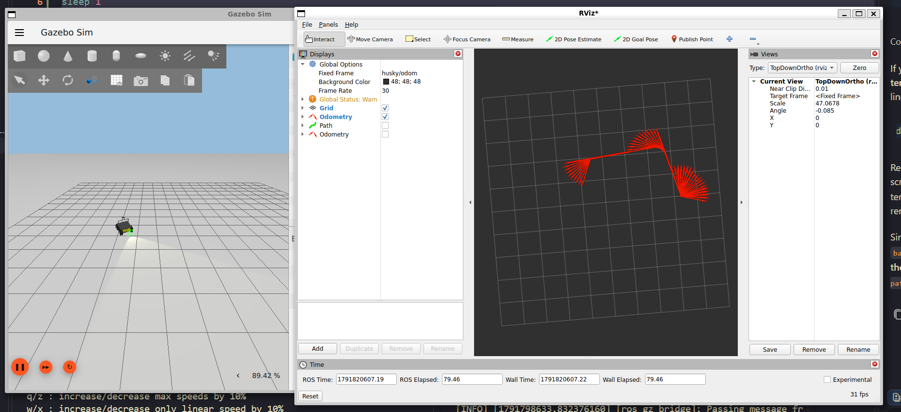
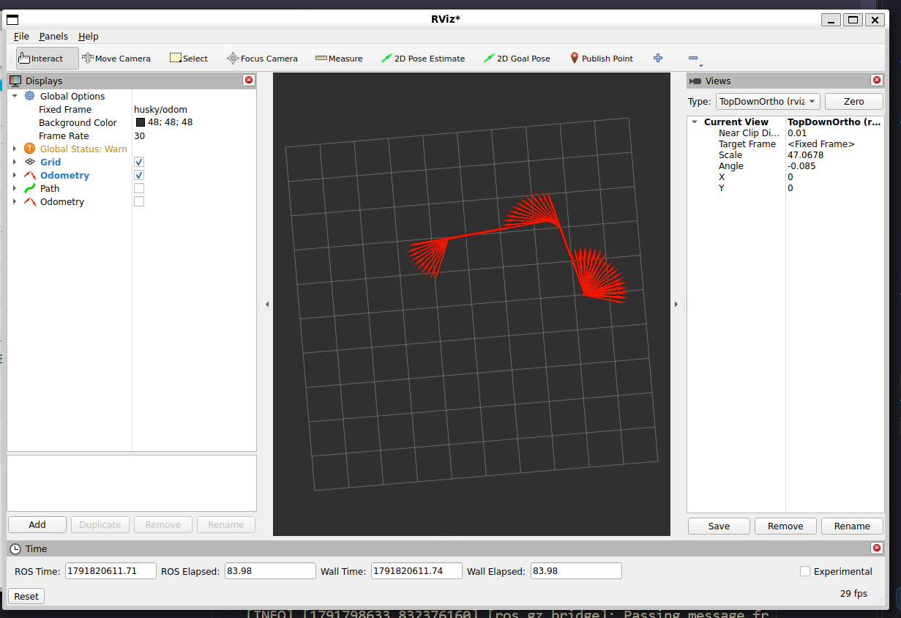
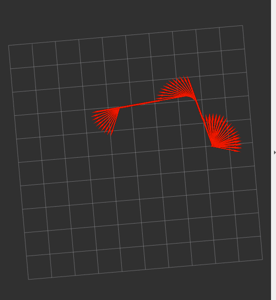

<p align="center">
  <a href="https://olehsamoilenko.github.io/aig-materials/">
    
  </a>
  <br>
  <a href="https://olehsamoilenko.github.io/aig-materials/"><b>Course page: Autonomous Robotic Systems Engineering</b></a>
</p>

# Lab 1 — Open source robot bring-up with ROS 2 and Gazebo

**Deadline:** <ins>October 12, 12:00</ins> (no push after deadline)

This lab takes a ready-made robot from the Gazebo Fuel catalogue and drives it from ROS 2. The robot gets velocity commands and sends back odometry, both as standard ROS 2 messages. It is driven from the terminal and from the keyboard, and its path is plotted from the odometry. Neither the robot model nor the keyboard tool is changed: they work together because they use the same message types.

## Materials

Lectures 0-3 on the [course page](https://olehsamoilenko.github.io/aig-materials/)

## Requirements

- [x] **Set up ROS 2 and Gazebo** — ROS 2 Jazzy and Gazebo Harmonic recommended.
- [x] **Create a world** — a `.sdf` file that includes a robot from [Gazebo Fuel](https://app.gazebosim.org/fuel) by its URL.
- [x] **Add a movement plugin** — a `<plugin>` in the `.sdf` world that moves the robot, e.g. `DiffDrive`.
- [x] **Set up the `ros_gz` bridge** — a `.yaml` file: commands in, `/odom` out.
- [x] **Write an odometry listener** — a node that subscribes to `/odom` and prints the robot position.
- [x] **Drive from the command line** — with `ros2 topic pub`.
- [x] **Drive from the keyboard** — with `teleop_twist_keyboard`, without changing it.
- [x] **Plot the path** — from the `/odom` data.

## Bonus

- [ ] **Launch file** — start the simulator, the bridge and the listener with one `ros2 launch`.
- [x] **RViz** — show the path in RViz.
- [x] **Distance check** — compare the commanded and the measured distance, and explain the difference.
- [ ] **Mission node** — a node that sends a fixed sequence of commands.
- [ ] **Bag replay** — record the drive with `ros2 bag` and replay it in RViz without the simulator.

## Expected file structure

```
lab-01-fuel-robot/
├── package.xml                  # package manifest
├── setup.py                     # install + odom_listener entry point
├── setup.cfg                    # install paths
├── resource/fuel_robot_lab      # empty package marker
├── fuel_robot_lab/
│   ├── __init__.py              # generated; find_packages() needs it
│   └── odom_listener.py         # prints the robot position from /odom
├── worlds/<name>.sdf            # ground, light, Fuel model, movement plugin
├── config/bridge.yaml           # ROS 2 ↔ Gazebo topics
├── scripts/plot_path.py         # path plot from /odom
├── media/                       # images, GIFs, plots
├── README.md                    # this task + your report
└── notes.txt                    # your thoughts, reflections, challenges, unclear points
```

---

# Report

## Run

1. Build the package and launch the odometry listener:

```bash
cd labs/lab_1
source /opt/ros/jazzy/setup.bash
colcon build --symlink-install
source install/setup.bash
ros2 run my_fuel_lab odom_listener
```

2. In a separate terminal, from the repository root, run the simulation script:

```bash
bash labs/lab_1/my_fuel_lab/scripts/run.sh
```

## Visualizations

Gazebo running the Fuel Husky alongside RViz:



Odometry visualization in RViz:



Odometry trail captured in RViz:


